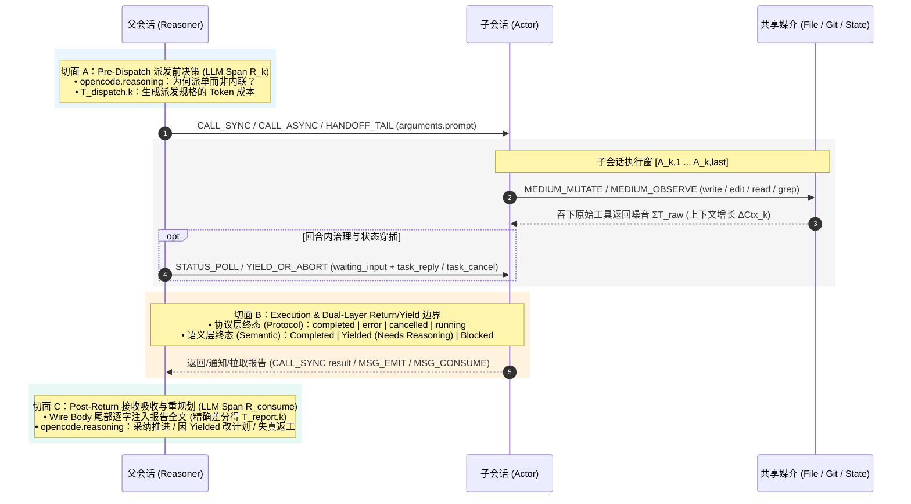

# 多 Agent 协作遥测、上下文带宽经济学与边界审计规范

本规范定义了评估多 Agent 协作（如 `Reasoner ↔ Actor`）有效性的理论方程、遥测语义契约与指标体系。架构设计遵循**开闭原则（Open-Closed Principle, OCP）**：
- 面向修改关闭（两个稳定内核）：
  1. OTel GenAI SemConv 标准遥测与四族九原语契约
  2. 上下文带宽与并发经济学方程 + 边界审计方法论
- 面向扩展开放（核心演进层）：日常研究与迭代的核心变化集中在指标与边界评估器注册表。

## 1. OTel GenAI SemConv 遥测契约与完备原语

### 1.1 三类基础 Span 与标准字段字典

所有智能体运行轨迹统一映射为 `AGENT`（回合/子智能体根）、`LLM`（单次模型推理）、`TOOL`（单次工具或跨 Agent 调用）三类 Span。核心计算仅依赖以下字段：

| 字段类别 | 字段路径 | 所在 Span | 物理含义与精确计量规则 |
|---|---|---|---|
| **标准 SemConv** | `gen_ai.conversation.id` | 全部 | 会话唯一 ID（与 `session.id` 等价），单会话轨迹归组键 |
| **标准 SemConv** | `gen_ai.operation.name` | 全部 | `chat`（LLM）/ `execute_tool`（TOOL）/ `invoke_agent`（AGENT）/ `compaction` |
| **标准 SemConv** | `gen_ai.usage.input_tokens` | `LLM` | 本次请求 Prefill Token 总数（**精确计量，不受属性截断影响**） |
| **标准 SemConv** | `gen_ai.usage.output_tokens` | `LLM` | 本次请求 Decode 生成 Token 总数（**含 `reasoning.output_tokens`**） |
| **标准 SemConv** | `gen_ai.usage.reasoning.output_tokens` | `LLM` | 思维链 Token 数；**可见输出 $\mathrm{out}_{\text{vis}} = \text{output\_tokens} - \text{reasoning.output\_tokens}$** |
| **标准 SemConv** | `gen_ai.usage.cache_read.input_tokens` | `LLM` | 命中 KV Cache 的 Prefill Token 数 |
| **标准 SemConv** | `gen_ai.tool.name` / `gen_ai.tool.call.id` | `TOOL` | 工具名与调用 ID（`call_*` 与下一轮 Wire Body 中 `role="tool"` 消息精确配对） |
| **标准 SemConv** | `gen_ai.tool.call.arguments` / `.result` | `TOOL` | 工具调用入参 JSON 与返回原文（同 `input.value` / `output.value`） |
| **标准 SemConv** | `gen_ai.output.messages` | `LLM` | Assistant 结构化可见文本输出 |
| **桥接槽位** | `opencode.agent` | `LLM/AGENT` | 当前会话所属角色（`reasoner` / `actor`；注意 `TOOL` 上的 `gen_ai.agent.name` 为**被调目标角色**） |
| **桥接槽位** | `opencode.session.parent_id` | `AGENT` | 子会话回指父会话的血缘外键 |
| **桥接槽位** | `opencode.reasoning` | `LLM` | 模型当轮思维链原文（切面 A 派单动机与切面 C 验收判断的一手证据） |
| **桥接槽位** | `opencode.wire.seq` + `input.value_original_length` | `LLM` | 当 `input.value` 触发 **61,440 字节（60KB）截断**时，按 `seq` 回源 `~/.local/share/opencode/raw-requests/ses_*.jsonl` 取回未截断尾部消息 |

### 1.2 跨 Agent 交互的“四族九原语”完备模型（4 Families, 9 Canonical Primitives）

为确保稳定内核不仅覆盖主从调用（RPC），还能完备表达业界全部 **7 种多 Agent 通信与协作范式**，跨智能体交互收敛为 **四族共 9 个规范原语**：

| 原语族 | 规范原语名称 | 物理定义与覆盖的协作范式 | OTel GenAI SemConv 落点（含 `omo-slim` 当前映射） |
|---|---|---|---|
| **族 I：控制流调用与移交** *(Coupled Control Flow)* | **1. `CALL_SYNC`** | 栈式同步调用与摘要返回，父挂起等待（**RPC Subagent**） | `subagent` `TOOL` Span 包裹子执行窗，结果直接返回 `<subagent … state="completed">` |
| | **2. `CALL_ASYNC`** | 非阻塞派生子执行流，立即返回句柄/Future（**异步 RPC / Actor 派生**） | `subagent` 返回 `The subagent is working in the background (sessionID: …)`；子轨迹异步延展 |
| | **3. `HANDOFF_TAIL`** | 尾调用单向移交控制权与裁剪后的上下文（继承率 $\alpha_{\text{inherit}}$），调用方退栈（$N_{\text{rem}}=0$）（**Handoff**） | 当前 `AGENT` 终止并产出移交 `TOOL` Span，新角色接力 |
| **族 II：异步消息与事件** *(Message & Event Bus)* | **4. `MSG_EMIT`** | 发送消息/事件：含单播唤醒（**Mailbox**）、多播事件（**Pub/Sub**）、公共转录追加（**Group Chat**） | 父下一轮 `LLM` Wire Body 尾部注入 `<subagent … state="completed" description="…">` 或 `task_message` |
| | **5. `MSG_CONSUME`** | 显式拉取/消费消息、事件或已完成子任务结果 | `task_status(result=true)` 的 `gen_ai.tool.call.result` + 下一轮父 `LLM` $\Delta\mathrm{in}$ |
| **族 III：共享媒介读写** *(Shared State & Environment)* | **6. `MEDIUM_MUTATE`** | 向共享媒介写入状态：状态图字段更新（**Blackboard**）或外部文件/Git Worktree 变更（**Stigmergy**） | 子/主会话内的 `write` / `edit` / Git 提交 `TOOL` Span |
| | **7. `MEDIUM_OBSERVE`** | 从共享媒介感知状态：读取黑板字段（**Blackboard**）或读取外部文件/环境变更（**Stigmergy**） | `read` / `grep` / `git diff` `TOOL` Span |
| **族 IV：异常、仲裁与轮询** *(Exception & Governance)* | **8. `STATUS_POLL`** | 对未就绪目标的非消费型轮询窥探（产生**纯轮询损耗 $C_{\text{poll}}$**） | `task_status(result≠true, diagnostic≠true)` 且目标仍为 `running` |
| | **9. `YIELD_OR_ABORT`** | 异常控制流反转：含中途挂起仲裁（`waiting_input` + `task_reply`）、回合末逻辑刹车（`Status: Yielded`）与父主动止损取消（`task_cancel` → 记入 **$C_{\text{rework}}$**） | `task_reply` / `task_cancel` `TOOL` Span，以及返回载荷的双层终态 `Protocol × Semantic` |

### 1.3 七大协作范式的原语组合与经济学参数统一表

定义无量纲**上下文泄漏/耦合系数 $\sigma_{\text{leak}} = \frac{T_{\text{rx}}}{\Delta T_{\text{work}}} = \frac{1}{\mathrm{NCR}}$**。7 种协作范式本质上是同一个经济学方程在不同参数区间下的特解：

> NCR = Noise Compression Ratio（上下文信噪压缩比 / 噪音压缩比）。它衡量的是：子会话（Actor）在本地吞下的原始探索与执行噪音，相对于它最终回传给主会话（Reasoner）的报告体积，被压缩了多少倍。

| 协作范式 | 通信耦合度 | 控制流特征 | 上下文隔离性 ($\sigma_{\text{leak}}$) | 典型框架与场景 | 对应的内核原语组合 | 在上下文经济学方程中的特征表现 |
|---|---|---|---|---|---|---|
| **1. RPC (Subagent)** | 强耦合 | 栈式调用与返回 | 强隔离，仅返摘要 ($\sigma_{\text{leak}} \ll 1$) | Claude Code Task / OpenCode 同步 `subagent` | `CALL_SYNC` + `YIELD_OR_ABORT` | $N_{\text{rem}} > 0$ 复利降噪显著；但阻塞式调用 $\Delta t_{\text{parallel}} = 0$ |
| **2. Handoff (移交)** | 中耦合 | 尾调用，单向接力 | 按需裁剪或全量 ($\sigma_{\text{leak}} = \alpha_{\text{inherit}}$) | OpenAI Swarm / Agents SDK | `HANDOFF_TAIL` | 调用方退栈（$N_{\text{rem}}^{\text{caller}}=0$）；仅当裁剪历史（$\alpha_{\text{inherit}} \ll 1$）时省 Prefill |
| **3. Mailbox (Actor)** | 寻址耦合 | 异步单播队列 | 强隔离，按消息传递 ($\sigma_{\text{leak}} \ll 1$) | Akka / 早期 AutoGen / `omo-slim` 后台任务 | `CALL_ASYNC` + `MSG_EMIT` + `MSG_CONSUME` + `STATUS_POLL` | 同时获得 $\sigma_{\text{leak}} \ll 1$ 降噪与 $\Delta t_{\text{parallel}} > 0$ 并行省时；需防 $C_{\text{poll}}$ 轮询税 |
| **4. Pub/Sub (事件)** | 完全解耦 | 异步广播与反应式 | 强隔离，按事件载荷 | AutoGen v0.4 / MetaGPT | `MSG_EMIT(multicast)` + `MSG_CONSUME` | $1 \to K$ 解耦并发；但若 $K$ 个订阅者被高频唤醒，总 Prefill 按 $\sum_{j=1}^K \mathrm{Ctx}_j$ 膨胀 |
| **5. Blackboard (黑板)** | 状态耦合 | 状态图/条件触发 | 共享结构化字段 ($\sigma_{\text{leak}} \to 0$) | LangGraph StateGraph | `MEDIUM_MUTATE(state)` + `MEDIUM_OBSERVE(state)` | 省去自然语言“派发/汇报小作文”（$T_{\text{dispatch}} \to 0$），Schema 约束压低传话失真 $p_{\text{loss}}$ |
| **6. Group Chat (群聊)** | 上下文耦合 | 主持人路由/竞标发言 | **无隔离，全员共享** ($\sigma_{\text{leak}} = 1 \sim M$) | CrewAI / 辩论竞技场 | `MSG_EMIT(shared_transcript)` | **方程左侧降噪项为负**：一人产生的废料被全场 $M$ 个 Agent 在后续 $N_{\text{rem}}$ 轮重复 Prefill |
| **7. Stigmergy (环境)** | 零运行时耦合 | 外部钩子/文件触发 | **极强，以文件为边界** ($\sigma_{\text{leak}} = 0$) | 多实例 Git Worktree 协同底座 | `MEDIUM_MUTATE(file/git)` + `MEDIUM_OBSERVE(file/git)` | 运行时通信税 $T_{\text{dispatch}}=T_{\text{report}}=0$，并行度最高；成本转移至读盘发现 $C_{\text{reload}}$ 与合并冲突 $C_{\text{rework}}$ |

> **混合范式本质**：`OpenCode + omo-slim` 实际是 **“控制流走 RPC/Mailbox（族 I/II）+ 重型代码产物走 Stigmergy（族 III 文件系统/Git Worktree）”的正交组合**。代码修改通过 `MEDIUM_MUTATE` 直接落盘（$\sigma_{\text{leak}}=0$），跨 `CALL_SYNC` 边界仅回传 `path:line` 摘要，这正是其能实现 $\mathrm{NCR} > 10:1$ 的物理前提。

## 2. 上下文带宽经济学方程与边界方法论

### 2.1 第一性原理决策不等式（分层模型）

在 LLM 推理引擎物理机制（Prefill 与 Decode 非对称单价与耗时、KV Cache 命中率、多轮自回归复利）下，主会话决定“内联自做（Inline）”还是“跨边界协作（Delegate）”的盈亏平衡模型按**三层结构**自顶向下展开。后续拓展新协作范式或新损耗维度时，只需在下层对应分项下横向挂载，保持顶层判据稳定。

#### 第一层：顶层盈亏平衡判据（Top-Level Equilibrium）

当且仅当跨边界协作带来的**总收益 $G_{\text{collab}}$** 大于跨边界引入的**总摩擦成本 $C_{\text{collab}}$** 时，派发决策在经济学上成立：

$$\Delta V_{\text{collab}} = G_{\text{collab}} - C_{\text{collab}} > 0 \quad \Longleftrightarrow \quad G_{\text{collab}} > C_{\text{collab}}$$

#### 第二层：收益端与成本端的正交维度拆分（Dimension Decomposition）

将不等式两端按物理作用机制拆解为 **2 项正交收益源** 与 **4 项全生命周期摩擦成本**：

$$\underbrace{G_{\text{ctx}} + G_{\text{time}}}_{G_{\text{collab}}\text{（协作总收益）}} \;>\; \underbrace{C_{\text{tx}} + C_{\text{state}} + C_{\text{gov}} + C_{\text{risk}}}_{C_{\text{collab}}\text{（协作总摩擦成本）}}$$

- **收益端 $G_{\text{collab}}$**：由 **主窗口上下文隔离降噪收益（$G_{\text{ctx}}$）** 与 **并发墙钟时间收益（$G_{\text{time}}$）** 构成；
- **成本端 $C_{\text{collab}}$**：由 **边界通信生成税（$C_{\text{tx}}$）**、**状态同步与冷启动税（$C_{\text{state}}$）**、**控制面轮询与验收税（$C_{\text{gov}}$）** 以及 **信息失真与返工期望成本（$C_{\text{risk}}$）** 构成。

#### 第三层：底层物理参数展开与非线性杠杆（Parameterization & Metric Binding）

将第二层的 6 个分项继续向下展开为可由 OTel GenAI SemConv 精确计量的叶子参数，并直接绑定至第 3 节的评估指标卡：

| 所属端 | 二层分项 | 三层叶子参数展开式 | 核心物理机制与非线性杠杆 | 绑定的指标卡 |
|---|---|---|---|---|
| **收益端** $G_{\text{collab}}$ | **$G_{\text{ctx}}$** *(上下文降噪收益)* | $$N_{\text{rem}} \cdot \Delta T_{\text{noise}} \cdot c_{\text{in}} + \Delta A_{\text{attn}}$$ 其中 $\Delta T_{\text{noise}} = \Delta T_{\text{work}}(1 - \sigma_{\text{leak}}) = \Delta T_{\text{Actor\_raw}} - T_{\text{report}}$ | **非线性放大器 $N_{\text{rem}}$（父会话剩余轮次）**：被隔离的过程噪音 $\Delta T_{\text{noise}}$ 省下的不是单次成本，而是避免在父会话后续 $N_{\text{rem}}$ 轮推理中被重复 Prefill $N_{\text{rem}}$ 次，并消除长窗口注意力稀释 $\Delta A_{\text{attn}}$ 与 Compaction 失忆 | **M1** ($\mathrm{NCR}$, $\mathrm{Saved}_k$) **M8** ($\Delta A_{\text{attn}}$) |
| | **$G_{\text{time}}$** *(并发时间收益)* | $$\Delta t_{\text{parallel}} = \sum_{k} \lvert W_k \rvert - \Bigl\lvert \bigcup_{k} W_k \Bigr\rvert$$ | **非阻塞多路扇出**：仅在 `CALL_ASYNC` / `MSG_EMIT` 并发执行正交子任务时激活；纯同步阻塞调用（`CALL_SYNC`）下 $G_{\text{time}} = 0$ | **M5** ($\Delta t_{\text{parallel}}$) |
| **成本端** $C_{\text{collab}}$ | **$C_{\text{tx}}$** *(边界通信生成税)* | $$T_{\text{dispatch}} \cdot c_{\text{out}} + T_{\text{report}} \cdot c_{\text{out}}$$ | **Decode 自回归高单价（$c_{\text{out}} \gg c_{\text{in}}$）**：父写派发指令与子写汇报摘要均走慢速 Decode；轻任务若套用重型汇报模板，$C_{\text{tx}}$ 会直接倒挂（除非走 Blackboard / Stigmergy 分流） | **M4** ($\mathrm{Friction}$) **M9**, **M10** |
| | **$C_{\text{state}}$** *(状态同步与冷启动税)* | $$(1 - \gamma_{\text{warm}}) \cdot C_{\text{reload}}$$ | **非线性坍缩器 $\gamma_{\text{warm}} \in [0, 1]$（热会话复用率）**：复用同一 `sessionID` 持续驱动“侦察 → 实现 → 验证”时 $\gamma_{\text{warm}} \to 1$，冷启动重复读盘成本 $C_{\text{reload}}$ 直接归零 | **M2** ($\gamma_{\text{warm}}$, `redundant`) |
| | **$C_{\text{gov}}$** *(控制面治理与验收税)* | $$C_{\text{poll}} + C_{\text{verify}}$$ | **非消费型轮询与仲裁开销**：含父会话违规调用 `STATUS_POLL` 产生的纯浪费 $C_{\text{poll}}$，以及切面 C 吸收报告或中途 `task_reply` 仲裁消耗的 $C_{\text{verify}}$ | **M5** ($C_{\text{poll}}$) **M7** |
| | **$C_{\text{risk}}$** *(失真与返工期望成本)* | $$p_{\text{loss}} \cdot C_{\text{rework}}$$ | **传话筒失真与止损返工**：跨边界上下文裁剪引发信息丢失或前提误判的概率 $p_{\text{loss}}$，乘以作废重跑或 `task_cancel` 止损所浪费的 Token 成本 $C_{\text{rework}}$ | **M3** ($C_{\text{rework}}$) **M6** ($p_{\text{loss}}$) |

### 2.2 边界模型（Boundary Model）

在拥有全量未截断 LLM Wire 请求数据的基础上，每次主从交互（第 $k$ 次派发）精确切分为三个观测切面：

* **双层终态正交性（Protocol State $\times$ Semantic Status）**：
  * **协议层终态（`protocol`）** 来自宿主执行器（`completed` / `error` / `cancelled` / `running`）；
  * **语义层状态（`status`）** 来自子智能体报告体（`Completed` / `Yielded (Needs Reasoning)` / `Blocked`）。
  * **关键边界观测点**：当子智能体因前提矛盾或跨模块冲突主动刹车，返回 `protocol="completed"` 且 `status="Yielded (Needs Reasoning)"` 时，切面 C 中父智能体能否**不亲自读源码、仅凭文字报告一次改对计划**，直接量化了“传话筒损耗 $p_{\text{loss}}$”的真实大小。

## 3. 协作指标与边界评估器注册表

本节是我们研究深入过程中**持续迭代与扩展的核心层**。所有指标均用第 1、2 节的稳定符号定义，每个指标按统一的“精确公式 → 物理判据”卡片注册。

### 3.1 已固化核心指标集

#### M1 — 上下文信噪压缩比（NCR）与复利 Prefill 节省量

* **精确差分公式**（基于 `gen_ai.usage.input_tokens` 差分，不受 60KB 属性截断与字符/Token 换算误差影响）：
  * **报告注入主窗口的精确 Token 数**（$R_{\text{consume}, k}$ 为收到报告后的首个父 LLM Span，$R_{\text{prev}, k}$ 为其紧邻上一轮父 LLM Span）：
    $$T_{\text{report}, k} = \mathrm{in}(R_{\text{consume}, k}) - \mathrm{in}(R_{\text{prev}, k}) - \mathrm{out}_{\text{vis}}(R_{\text{prev}, k})$$
  * **子会话单轮吸收的精确上下文增量**（记子会话第 $j$ 轮末个 LLM Span 的总上下文为 $\mathrm{ctx}_j = \mathrm{in}(A_{j,\text{last}}) + \mathrm{out}_{\text{vis}}(A_{j,\text{last}})$）：
    $$\Delta \mathrm{Ctx}_k = \mathrm{ctx}_k - \mathrm{ctx}_{k-1}$$
  * **双口径 NCR 与复利节省量**：
    $$\mathrm{NCR}_{\text{ctx}, k} = \frac{\Delta \mathrm{Ctx}_k}{T_{\text{report}, k}}, \qquad \mathrm{NCR}_{\text{char}, k} = \frac{\sum_{t \in \text{Actor TOOL}_k} \mathrm{len}(\text{result}_t)}{\mathrm{len}(\text{report}_k)}$$
    $$\mathrm{Saved}_k = N_{\text{rem}, k} \times \left(\Delta T_{\text{noise}, k} - T_{\text{report}, k}\right)$$
* **物理判据（Verdict 阈值）**：
  * `HIGH_GAIN`（$\mathrm{NCR}_{\text{ctx}} \ge 8:1$）：子会话替主脑挡住海量废料，隔离策略显著胜出；
  * `MODERATE_GAIN`（$2:1 \le \mathrm{NCR}_{\text{ctx}} < 8:1$）：温和正收益，通常依赖热复用（$\gamma_{\text{warm}}=1$）免除冷启动才不亏；
  * `MARGINAL_OVERHEAD`（$\mathrm{NCR}_{\text{ctx}} < 2:1$）：汇报小作文接近甚至超过原始工具输出，派发为纯负收益。

#### M2 — 热会话命中率（$\gamma_{\text{warm}}$）与区间感知重复读盘率

* **计算公式**：
  $$\gamma_{\text{warm}} = \frac{\lvert \{k \mid \text{sessionID}_k \neq \varnothing\} \rvert}{K}$$
* **区间感知读盘分类**（提取 `MEDIUM_OBSERVE(read)` 的 `(path, [offset, offset+limit))`，对比同一 `path` 已读区间并集 $\mathcal{I}_{\text{prev}}$）：
  * `disjoint`（不相交，$\lvert I_{\text{cur}} \cap \mathcal{I}_{\text{prev}} \rvert = 0$）：正常大文件分段翻页，**不计入冗余**；
  * `partial`（部分重叠）：跨页边界衔接；
  * `redundant`（完全包含，$I_{\text{cur}} \subseteq \mathcal{I}_{\text{prev}}$）：**真重复读盘浪费**（反映冷启动重载 $C_{\text{reload}}$ 失控或主窗口失忆）。
* **物理判据**：跨轮次真重复读盘率 `redundant` 应 $< 10\%$；若同一文件被主/子或不同子会话反复重读 $>2$ 次，说明 `sessionID` 未复用或并发拆分破坏了模块正交性。

#### M3 — 双层边界终态、交接返工率与显式止损成本（$C_{\text{rework}}$）

* **计算公式**：
  * 每次边界记录二元组 $(\text{protocol}_k, \text{status}_k)$；
  * 异常/返工边界集合：$K_{\text{rework}} = \{k \mid \text{protocol}_k \in \{\text{error}, \text{cancelled}\} \lor \text{status}_k \in \{\text{Yielded}, \text{Blocked}\} \lor \text{YIELD\_OR\_ABORT}_k\}$；
  * 显式取消返工成本 $C_{\text{rework}}$：被 `task_cancel(reason)` 中止的子会话在该轮已消耗的全部 Token。
* **物理判据**：区分“有益刹车（`Yielded` 后切面 C 单轮改对计划）”与“失真返工（因指令不清或汇报遗漏导致同一目标重复派单）”。

#### M4 — 分类 Token 账单、主脑峰值比与“小作文”摩擦占比

* **计算公式**：
  * **主脑峰值窗口（Context Peak）**：$\mathrm{Peak}(S) = \max_{m \in \text{LLM}(S)} \mathrm{in}(m)$；
  * **热复用派发指令精确 Token（$k \ge 2$）**：$T_{\text{dispatch}, k} = \mathrm{in}(A_{k,1}) - \mathrm{ctx}_{k-1}$（冷启动 $k=1$ 按 `len(prompt) / 2.35` 估算）；
  * **交接小作文摩擦占比（Handoff Essay Friction Share）**：
    $$\mathrm{Friction}_{\text{parent}} = \frac{\sum_k T_{\text{dispatch}, k}}{\sum_{m \in R} \mathrm{out}_{\text{vis}}(m)}, \qquad \mathrm{Friction}_{\text{child}} = \frac{\sum_k T_{\text{report}, k}}{\sum_{n \in A} \mathrm{out}_{\text{vis}}(n)}$$
* **物理判据**：监控 $\mathrm{Peak}(R)$ 是否始终维持在清爽水位（如 $<40\text{k}$），并评估针对轻量验证任务压缩汇报模板后 $\mathrm{Friction}_{\text{child}}$ 的下降幅度。

#### M5 — 并行时间收益（$\Delta t_{\text{parallel}}$）与控制面轮询浪费（$C_{\text{poll}}$）

* **计算公式**：
  * 对 `CALL_ASYNC` 派发，以子会话真实执行区间 $W_k = [t_{\text{launch}, k}, t_{\text{delivery/end}, k}]$（而非启动句柄耗时）计算：
    $$\Delta t_{\text{parallel}} = \sum_{k} \lvert W_k \rvert - \Bigl\lvert \bigcup_{k} W_k \Bigr\rvert, \qquad \mathrm{Speedup\%} = \frac{\Delta t_{\text{parallel}}}{\sum_k \lvert W_k \rvert}$$
  * 轮询浪费 $C_{\text{poll}}$：所有 `STATUS_POLL` 事件的次数及其注入父窗口的 Token 总和。

### 3.2 待拓展研究指标槽位（M6+ 演进路线图）

随着后续压测深入，直接在注册表中横向追加以下指标卡，无需改动内核 A/B：

| 指标编号 | 指标名称 | 推算输入与评估逻辑 | 针对的方程项 / 核心问题 |
|---|---|---|---|
| **M6** | **`Yielded` 一击修复率（One-Shot Re-Plan Rate）** | 取所有 `status_k == "Yielded (Needs Reasoning)"` 的边界，检验切面 C（$R_{\text{consume}, k}$）是否在**无需父会话亲自 `read` 源码**的前提下，于 $k+1$ 次派发一次通过（`status_{k+1} == "Completed"`） | 直接测量 `Yielded` 关键边界上的传话筒信息损耗 $p_{\text{loss}}$ |
| **M7** | **中途挂起恢复比（Mid-Flight Escalation Efficiency）** | 对比走 `waiting_input` + `task_reply`（回合内恢复）与走回合末 `Status: Yielded`（重开下一轮）的平均耗时和额外 Token 开销 | 优化双档位 Yield 机制的边界阈值 |
| **M8** | **注意力稀释与 Compaction 失忆代理指标（$\Delta A_{\text{attn}}$ Proxy）** | 计算会话内 `input_tokens` 跨过不同水位线（如 50k / 100k / 150k）或发生 `compaction` 后，`redundant` 重复读盘率与工具调用失败率的斜率跃升 | 将抽象的注意力稀释 $\Delta A_{\text{attn}}$ 转化为可观测的退化曲线 |
| **M9** | **Stigmergy 载荷分流比（Artifact Offload Ratio）** | $\frac{\sum \mathrm{len}(\text{MEDIUM\_MUTATE 写入盘面的代码/文档字节})}{\mathrm{len}(\text{CALL\_SYNC/MSG\_CONSUME 跨边界报告字节})}$ | 量化文件系统/Worktree 替 RPC 通道分流了多少倍的重型载荷 |
| **M10** | **自适应汇报压缩比（Adaptive Report Compactness）** | 按子回合工具调用数分桶（轻任务 $\le 4$ 次工具 vs 重任务 $>10$ 次工具），监控引入“轻任务单行汇报规则”前后的 $T_{\text{report}}$ 与 $\mathrm{NCR}$ 变化 | 解决轻任务（如实测 $k=4$）因固定汇报模板过重导致 $\mathrm{NCR}$ 逼近盈亏线的问题 |

## 4. 架构预留扩展槽（编排底座与可观测平台适配）

当前工程实现固定为 **OpenCode + `oh-my-opencode-slim`（前端编排）** 与 **Arize Phoenix（后端可观测平台）**。未来若需横向迁移，仅需按以下最小契约替换适配层：

1. **预留扩展槽 1 — 前端 Agent 编排底座（当前：`OpenCode + omo-slim`，未来可扩展：`dsh` / `Claude Code` 等）**：
   * 只需提供 **5 项字段映射** 即可接入本规范：① 会话角色与父子血缘字段（当前为 `opencode.agent` + `opencode.session.parent_id`）；② 九原语对应的工具名与同步/异步返回特征；③ 思考链文本字段（当前为 `opencode.reasoning`）；④ 文件读取工具的 `(path, offset, limit)` 提取规则；⑤ Span 属性截断时的无损 Wire Body 回源路径（当前为 `opencode.wire.seq` $\leftrightarrow$ `raw-requests/ses_*.jsonl`）。
2. **预留扩展槽 2 — 后端可观测平台（当前固定：`Arize Phoenix`）**：
   * 指标计算层只消费归一化后的 Span 列表与 Wire 帧，不绑定存储引擎。当前通过 Phoenix 的三种只读方式取数：SQLite `mode=ro` 直读（`phoenix.db`）、GraphQL API（`localhost:6006/graphql`）与会话内按需调用的 Phoenix MCP（`executeSql`）。

## 5. 参考资料

1. 配套实测数据与基准对照见：[react-mode-eval-benchmarks.md](react-mode-eval-benchmarks.md)
