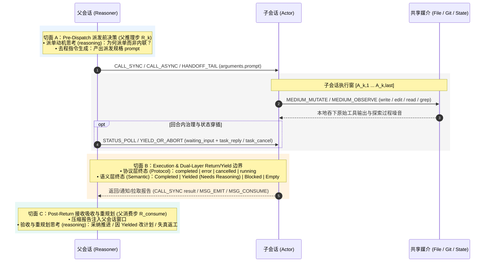

# 多 Agent 协作模式研究与评估

本规范围绕“多 Agent 协作（如 `Reasoner ↔ Actor`）如何能真正优于单 Agent one loop 执行，以及如何用真实运行数据持续调优协作边界”这一核心问题，按以下**五步闭环逻辑**组织：

1. **交互原语与单次边界模型（§1）**：先梳理不同 Agent 之间信息交互的完备原语，并刻画单次跨 Agent 交互内部的三切面边界过程；
2. **上下文带宽经济学原理（§2）**：引入协作收益与摩擦成本的盈亏平衡不等式，从原理上回答“什么任务值得拆、什么摩擦会毁掉协作”；
3. **Agent 可观测遥测标准（§3）**：定义基于 OTel GenAI SemConv 的标准 Span 与字段契约，明确从实际运行轨迹中能采集到哪些精确数据；
4. **分项展开、实测指标与范式映射（§4）**：将 §2 的经济学分项与 §3 的遥测数据逐项对接，在每个分项下统一给出**理论公式、实测计算指标与反馈优化判据**，并汇总协作范式参数表。

> **开闭原则（OCP）**：**交互模型、经济学原理与可观测底座面向修改关闭**，作为跨框架通用的稳定内核；**各分项及其实测指标与反馈判据面向扩展开放**，随实测压测与调优持续演进。

## 1. Agent 信息交互原语与边界模型

### 1.1 跨 Agent 信息交互原语

为表达业界 **多 Agent 通信与协作范式**，不同 Agent 之间的信息交互收敛为以下 **规范原语**（各范式与原语组合、经济学特征的逐项对照见 4.3 节统一表）：

| 原语族 | 规范原语名称 | 物理定义与覆盖的协作范式 | 轨迹可观测落点（详见 §3 标准字段与 `omo-slim` 映射） |
|---|---|---|---|
| **族 I：控制流调用与移交** *(Coupled Control Flow)* | **1. `CALL_SYNC`** | 栈式同步调用与摘要返回，父会话挂起等待（**RPC Subagent**） | `subagent` `TOOL` Span 包裹子执行窗，结果直接返回 `<subagent … state="completed">` |
| | **2. `CALL_ASYNC`** | 非阻塞派生子执行流，立即返回句柄/Future（**异步 RPC / Actor 派生**） | `subagent` 返回 `The subagent is working in the background (sessionID: …)`；子轨迹异步延展 |
| | **3. `HANDOFF_TAIL`** | 尾调用单向移交控制权与裁剪后的上下文，原调用方退栈不再继续后续推理（**Handoff**） | 当前 `AGENT` 终止并产出移交 `TOOL` Span，新角色接力 |
| **族 II：异步消息与事件** *(Message & Event Bus)* | **4. `MSG_EMIT`** | 发送消息/事件：含单播唤醒（**Mailbox**）、多播事件（**Pub/Sub**）、公共转录追加（**Group Chat**） | 父下一轮 `LLM` 输入尾部注入 `<subagent … state="completed" description="…">` 或 `task_message` |
| | **5. `MSG_CONSUME`** | 显式拉取/消费消息、事件或已完成子任务结果 | `task_status(result=true)` 的工具返回结果 + 下一轮父 `LLM` 输入增量 |
| **族 III：共享媒介读写** *(Shared State & Environment)* | **6. `MEDIUM_MUTATE`** | 向共享媒介写入状态：状态图字段更新（**Blackboard**）或外部文件/Git Worktree 变更（**Stigmergy**） | 子/主会话内的 `write` / `edit` / Git 提交 `TOOL` Span |
| | **7. `MEDIUM_OBSERVE`** | 从共享媒介感知状态：读取黑板字段（**Blackboard**）或读取外部文件/环境变更（**Stigmergy**） | `read` / `grep` / `git diff` `TOOL` Span |
| **族 IV：异常、仲裁与轮询** *(Exception & Governance)* | **8. `STATUS_POLL`** | 对未就绪目标的非消费型轮询窥探（仅查状态、未取回结果，产生纯轮询浪费） | `task_status(result≠true, diagnostic≠true)` 且目标仍为 `running` |
| | **9. `YIELD_OR_ABORT`** | 异常控制流反转：含中途挂起仲裁（`waiting_input` + `task_reply`）、回合末逻辑刹车（`Status: Yielded`）与父主动止损取消（`task_cancel`） | `task_reply` / `task_cancel` `TOOL` Span，以及返回载荷的双层终态 `Protocol × Semantic` |

### 1.2 单次跨 Agent 交互边界模型（Three-Cut Boundary Model）

聚焦到单次主从交互（第 $k$ 次派发），一个 Agent 从发起委托、子 Agent 内部执行、到结果回传被主 Agent 吸收的全过程，按时间轴精确切分为 **A / B / C 三个交互切面**：

* **执行态与业务态双层分离（宿主执行成败 Protocol $\neq$ 任务目标达成 Semantic）**：
  * **协议层终态（`protocol`）** 来自宿主执行器（`completed` / `error` / `cancelled` / `running`）；
  * **语义层状态（`status`）** 来自子智能体报告体（`Completed` / `Yielded (Needs Reasoning)` / `Blocked`），以及宿主显示 `completed` 但返回载荷长度为 0 的**静默空返回退化态（`Empty`）**。
  * **关键边界观测点**：当子智能体因前提矛盾或跨模块冲突主动刹车，返回 `protocol="completed"` 且 `status="Yielded (Needs Reasoning)"` 时，切面 C 中父智能体能否**不亲自读源码、仅凭文字报告一次改对计划**，直接反映了跨边界信息传递的保真度；当遭遇 `Empty` 静默空返回（如热子会话触顶崩溃）时，切面 C 必须触发带锚点换仓冷启动（Session Rotation），禁止回退为父会话连续内联工具流。

## 2. Agent 交互的上下文带宽经济学原理

在明确了交互原语（§1.1）与三切面边界（§1.2）后，需要从 LLM 推理引擎的底层物理机制（Prefill 与 Decode 非对称单价与耗时、KV Cache 命中率、多轮自回归复利）出发，建立判断“内联自做（Inline）”还是“跨边界派发（Delegate）”的经济学原理。

### 2.1 第一层：顶层盈亏平衡判据（Top-Level Equilibrium）

当且仅当跨边界协作带来的**总收益 $G_{\text{collab}}$** 大于跨边界引入的**总摩擦成本 $C_{\text{collab}}$** 时，派发决策在经济学上成立：

$$\Delta V_{\text{collab}} = G_{\text{collab}} - C_{\text{collab}} > 0 \quad \Longleftrightarrow \quad G_{\text{collab}} > C_{\text{collab}}$$

### 2.2 第二层：收益与成本的构成分解（Dimension Decomposition）

将不等式两端按物理作用机制拆解为 **2 项互补收益（空间省窗口 + 时间省等待）** 与 **4 项全生命周期摩擦成本**（各分项独立核算、互不重叠）：

$$\underbrace{G_{\text{ctx}} + G_{\text{time}}}_{G_{\text{collab}}\text{（协作总收益）}} \;>\; \underbrace{C_{\text{tx}} + C_{\text{state}} + C_{\text{gov}} + C_{\text{risk}}}_{C_{\text{collab}}\text{（协作总摩擦成本）}}$$

- **收益端 $G_{\text{collab}}$**：由 **主窗口上下文隔离降噪收益（$G_{\text{ctx}}$）** 与 **并发墙钟时间收益（$G_{\text{time}}$）** 构成；
- **成本端 $C_{\text{collab}}$**：由 **边界通信生成税（$C_{\text{tx}}$）**、**状态同步与冷启动税（$C_{\text{state}}$）**、**控制面轮询与验收税（$C_{\text{gov}}$）** 以及 **信息失真与返工期望成本（$C_{\text{risk}}$）** 构成。

> 要将上述理论分项进一步展开为可从实际运行中精确计算的物理公式，必须先明确我们在运行时能采集到哪些标准遥测数据，再将遥测字段代入上述模型完成计算。

## 3. Agent 可观测遥测标准（OTel GenAI SemConv 契约）

所有智能体运行轨迹统一映射为 `AGENT`（回合/子智能体根）、`LLM`（单次模型推理）、`TOOL`（单次工具或跨 Agent 调用）三类 Span。核心计算仅依赖以下字段：

| 字段类别 | 字段路径 | 所在 Span | 物理含义与精确计量规则 |
|---|---|---|---|
| **标准 SemConv** | `gen_ai.conversation.id` | 全部 | 会话唯一 ID（与 `session.id` 等价），单会话轨迹归组键 |
| **标准 SemConv** | `gen_ai.operation.name` | 全部 | `chat`（LLM）/ `execute_tool`（TOOL）/ `invoke_agent`（AGENT）/ `compaction` |
| **标准 SemConv** | `gen_ai.usage.input_tokens` | `LLM` | 本次请求 Prefill Token 总数（**精确计量，不受属性截断影响**） |
| **标准 SemConv** | `gen_ai.usage.output_tokens` | `LLM` | 本次请求 Decode 生成 Token 总数（**含 `reasoning.output_tokens`**） |
| **标准 SemConv** | `gen_ai.usage.reasoning.output_tokens` | `LLM` | 思维链 Token 数；**可见输出 $\mathrm{out}_{\text{vis}} = \text{output\_tokens} - \text{reasoning.output\_tokens}$** |
| **标准 SemConv** | `gen_ai.usage.cache_read.input_tokens` | `LLM` | 命中 KV Cache 的 Prefill Token 数 |
| **标准 SemConv** | `gen_ai.tool.name` / `gen_ai.tool.call.id` | `TOOL` | 工具名与调用 ID（`call_*` 与下一轮 Wire Body 中 `role="tool"` 消息精确配对） |
| **标准 SemConv** | `gen_ai.tool.call.arguments` / `.result` | `TOOL` | 工具调用入参 JSON 与返回原文（同 `input.value` / `output.value`） |
| **标准 SemConv** | `gen_ai.output.messages` | `LLM` | Assistant 结构化输出（ChatMessage Schema）：`[{"role":"assistant","parts":[…]}]`，parts 含标准 **`{"type":"reasoning","content":…}` ReasoningPart**（思维链原文——切面 A 派单动机与切面 C 验收判断的一手证据；reasoning parts 位于 text parts 之前，事件流不携带序号故不伪造交错；纯思考步也记录）与 `{"type":"text"}` 可见文本；遵循「一个事实一个家」单源归属原则，`LLM` Span 仅记录思考与发言，工具调用的入参、结果与耗时归属在专用 `TOOL` Span，不重复折叠。|
| **桥接槽位** | `opencode.agent` | `LLM/AGENT` | 当前会话所属角色（`reasoner` / `actor`；注意 `TOOL` 上的 `gen_ai.agent.name` 为**被调目标角色**） |
| **桥接槽位** | `opencode.session.parent_id` | `AGENT` | 子会话回指父会话的血缘外键 |
| **桥接槽位** | `opencode.wire.seq` + `input.value_original_length` | `LLM` | 当 `input.value` 触发 **61,440 字节（60KB）截断**时，按 `seq` 回源 `~/.local/share/opencode/raw-requests/ses_*.jsonl` 取回未截断尾部消息 |

## 4. 模型的可观测参数展开与范式映射

有了 §1 的交互边界模型、§2 的经济学不等式与 §3 的 OTel 标准字段，现在将 §2 的分项精确映射为可由轨迹数据直接计量的物理参数。

### 4.1 单次往返的基础物理量与双向边界效率比（一进一出对偶）

先按一次完整往返，定义基础物理量与两组边界效率比:
**“父派单（切面 A）$\to$ 子执行 $\to$ 子汇报（切面 B）$\to$ 父继续推理（切面 C）”**

**1. 单次跨边界往返的基础物理量**
* **去程指令量 $T_{\text{dispatch}}$**：父会话在切面 A 生成派发指令（`prompt`）消耗的 Token 数；
* **子会话重取税 $T_{\text{reload}}$**：因去程信息传递不足，子会话进场后被迫重新读取/搜索主会话（或前序子会话）已知信息所浪费的 Token 数；
* **子会话原始工作量 $\Delta T_{\text{work}}$**：子会话在本地执行窗吞下的全部工具输出与中间推理上下文增量 Token 数；
* **回程汇报量 $T_{\text{report}}$**：子会话将执行过程压缩后回传、在切面 C 注入父会话窗口的报告 Token 数（在通用消息范式中即接收端载荷）；
* **计价与复利基准**：输入 Prefill 单价 $c_{\text{in}}$、输出 Decode 单价 $c_{\text{out}}$（物理上 $c_{\text{out}} \gg c_{\text{in}}$），以及父会话在当前任务片段（Episode）内还需继续推理的**剩余轮次 $N_{\text{rem}}^{\text{ep}}$**。

**2. 由基础量导出的双向边界效率比**
* **回程压缩效率（Child $\to$ Parent，用 $\Delta T_{\text{work}}$ 与 $T_{\text{report}}$ 相除，详见 4.2.1 `[M1]`）**：
  $$\mathrm{NCR} = \frac{\Delta T_{\text{work}}}{T_{\text{report}}} \quad\text{（上下文信噪压缩比）}, \qquad \sigma_{\text{leak}} = \frac{T_{\text{report}}}{\Delta T_{\text{work}}} = \frac{1}{\mathrm{NCR}} \quad\text{（上下文泄漏系数）}$$
  由此直接得到**单次替父窗口挡住的过程噪音净额**：$\Delta T_{\text{noise}} = \Delta T_{\text{work}} - T_{\text{report}} = \Delta T_{\text{work}}(1 - \sigma_{\text{leak}})$。
* **去程自足效率（Parent $\to$ Child，用 $T_{\text{reload}}$ 与 $T_{\text{dispatch}}$ 相除，详见 4.2.4 `[M2]`）**：
  $$\mathrm{RAR} = \frac{T_{\text{reload}}}{T_{\text{dispatch}}} \quad\text{（二次重取放大比）}, \qquad \mathrm{DSR} = \frac{T_{\text{dispatch}}}{T_{\text{dispatch}} + T_{\text{reload}}} = \frac{1}{1+\mathrm{RAR}} \quad\text{（派发信息自足率）}$$
  衡量父会话传给子会话的信息是否够用（$\mathrm{RAR}=0$ 即 $\mathrm{DSR}=100\%$，代表零重取；$\mathrm{RAR} \ge 1$ 代表子会话重取已知信息的代价已超过派发指令本身）。

### 4.2 分项展开

#### 4.2.1 主窗口上下文隔离降噪收益（$G_{\text{ctx}}$）

* **分项展开式与物理机制**：
  $$G_{\text{ctx}} = N_{\text{rem}}^{\text{ep}} \cdot \Delta T_{\text{noise}} \cdot c_{\text{in}} + \Delta A_{\text{attn}}, \qquad \Delta T_{\text{noise}} = \Delta T_{\text{work}} - T_{\text{report}} = \Delta T_{\text{work}}(1 - \sigma_{\text{leak}})$$
  * **非线性复利乘子 $N_{\text{rem}}^{\text{ep}}$（片段内父会话剩余轮次）**：被挡在子会话内的过程噪音 $\Delta T_{\text{noise}}$ 省下的不是单次成本，而是避免在父会话后续 $N_{\text{rem}}^{\text{ep}}$ 轮推理中被反复 Prefill。乘子以**当前任务片段（Episode）**为界——终止于父会话下一次 `compaction`、轮间空闲间隔 $\Delta t_{\text{idle}} > \tau_{\text{ep}}$（默认 30 min）或会话结束（`compaction` / `idle_gap` / `session_end` 三种终止因），防止把数小时后无关任务的轮次虚记为本次隔离收益（实测 $k{=}1$ 全会话原始 $N_{\text{rem}}{=}46$，片段内 $N_{\text{rem}}^{\text{ep}}{=}8$，虚增 ~5.75×）。
  * **注意力保真收益 $\Delta A_{\text{attn}}$**：保持父窗口短小所免除的长上下文注意力稀释与 Compaction 摘要失忆损耗。
* **实测计量公式（`[M1]` 信噪压缩比与复利节省量 + `[M4]` 主脑峰值水位）**：
  * **报告注入主窗口的精确 Token 数**（$R_{\text{consume}, k}$ 为收到报告后的首个父 LLM Span，$R_{\text{prev}, k}$ 为其紧邻上一轮父 LLM Span）：
    $$T_{\text{report}, k} = \mathrm{in}(R_{\text{consume}, k}) - \mathrm{in}(R_{\text{prev}, k}) - \mathrm{out}_{\text{vis}}(R_{\text{prev}, k})$$
  * **子会话单轮吸收的精确上下文增量**（记子会话第 $j$ 轮末个 LLM Span 的总上下文为 $\mathrm{ctx}_j = \mathrm{in}(A_{j,\text{last}}) + \mathrm{out}_{\text{vis}}(A_{j,\text{last}})$）：
    $$\Delta \mathrm{Ctx}_k = \mathrm{ctx}_k - \mathrm{ctx}_{k-1}$$
  * **双口径 $\mathrm{NCR}$、复利节省量与主脑峰值**：
    $$\mathrm{NCR}_{\text{ctx}, k} = \frac{\Delta \mathrm{Ctx}_k}{T_{\text{report}, k}}, \qquad \mathrm{NCR}_{\text{char}, k} = \frac{\sum_{t \in \text{Actor TOOL}_k} \mathrm{len}(\text{result}_t)}{\mathrm{len}(\text{report}_k)}, \qquad \mathrm{Saved}_k = N_{\text{rem}, k}^{\text{ep}} \cdot \Delta T_{\text{noise}, k} = N_{\text{rem}, k}^{\text{ep}} \cdot \left(\Delta T_{\text{work}, k} - T_{\text{report}, k}\right)$$
    $$\mathrm{Peak}(R) = \max_{m \in \text{LLM}(R)} \mathrm{in}(m)$$
* **反馈判据与演进方向**：
  * `HIGH_GAIN`（$\mathrm{NCR}_{\text{ctx}} \ge 8:1$）：子会话替主脑挡住海量废料，隔离策略显著胜出；
  * `MODERATE_GAIN`（$2:1 \le \mathrm{NCR}_{\text{ctx}} < 8:1$）：温和正收益，通常依赖热复用（$\gamma_{\text{warm}}=1$）免除冷启动才不亏；
  * `MARGINAL_OVERHEAD`（$\mathrm{NCR}_{\text{ctx}} < 2:1$）：汇报小作文接近甚至超过原始工具输出，派发为纯负收益；
  * **主脑清爽水位**：父会话 $\mathrm{Peak}(R)$ 应始终维持在清爽水位（如 $< 40\text{k}$ tok）；
  * **演进指标 `[M8]`（注意力稀释与 Compaction 失忆代理指标 $\Delta A_{\text{attn}}$ Proxy）**：计算会话内 `input_tokens` 跨过不同水位线（如 50k / 100k / 150k）或发生 `compaction` 后，`redundant` 重复读盘率与工具调用失败率的斜率跃升，将 $\Delta A_{\text{attn}}$ 转化为可观测退化曲线。

#### 4.2.2 并发墙钟时间收益（$G_{\text{time}}$）

* **分项展开式与物理机制**：
  $$\Delta t_{\text{parallel}} = \sum_{k} \lvert W_k \rvert - \Bigl\lvert \bigcup_{k} W_k \Bigr\rvert, \qquad \mathrm{Speedup\%} = \frac{\Delta t_{\text{parallel}}}{\sum_k \lvert W_k \rvert}$$
  * **非阻塞多路扇出**：各子任务耗时的算术和减去并集实际墙钟跨度，即为并发重叠省下的时间 $\Delta t_{\text{parallel}}$。仅在 `CALL_ASYNC` / `MSG_EMIT` 并发执行**互不冲突（读写隔离）的子任务**时 $>0$；纯同步阻塞调用（`CALL_SYNC`）下 $G_{\text{time}} = 0$。
* **实测计量公式与判据（`[M5]` 并行时间收益）**：
  * 对 `CALL_ASYNC` 派发，以子会话真实执行区间 $W_k = [t_{\text{launch}, k}, t_{\text{delivery/end}, k}]$（而非父会话获取启动句柄的瞬时耗时）计算并发省时与加速比。

#### 4.2.3 边界通信生成税（$C_{\text{tx}}$）

* **分项展开式与物理机制**：
  $$C_{\text{tx}} = T_{\text{dispatch}} \cdot c_{\text{out}} + T_{\text{report}} \cdot c_{\text{out}}$$
  * **Decode 自回归高单价（$c_{\text{out}} \gg c_{\text{in}}$）**：父写派发指令 $T_{\text{dispatch}}$ 与子写汇报摘要 $T_{\text{report}}$ 均走慢速高价 Decode；轻任务若套用重型汇报模板，$C_{\text{tx}}$ 会直接超过降噪收益 $G_{\text{ctx}}$（倒挂）。
* **实测计量公式（`[M4]` 交接小作文摩擦占比与单次派发净收益）**：
  * **热复用派发指令精确 Token（$k \ge 2$）**：$T_{\text{dispatch}, k} = \mathrm{in}(A_{k,1}) - \mathrm{ctx}_{k-1}$（冷启动 $k=1$ 按 `len(prompt) / 2.35` 估算）；
  * **交接小作文摩擦占比（Handoff Essay Friction Share）**：
    $$\mathrm{Friction}_{\text{parent}} = \frac{\sum_k T_{\text{dispatch}, k}}{\sum_{m \in R} \mathrm{out}_{\text{vis}}(m)}, \qquad \mathrm{Friction}_{\text{child}} = \frac{\sum_k T_{\text{report}, k}}{\sum_{n \in A} \mathrm{out}_{\text{vis}}(n)}$$
  * **单次派发折算净收益与最小摊销轮次**（记输出/输入单价倍率 $\beta = c_{\text{out}} / c_{\text{in}}$）：
    $$\mathrm{NetSaved}_k = \mathrm{Saved}_k - \beta \cdot (T_{\text{dispatch}, k} + T_{\text{report}, k}) > 0 \quad \Longleftrightarrow \quad N_{\text{rem}, k}^{\text{ep}} > N_{\text{rem}, k}^* = \frac{\beta \cdot (T_{\text{dispatch}, k} + T_{\text{report}, k})}{\Delta T_{\text{noise}, k}}$$
    即父会话在当前片段内的剩余轮次 $N_{\text{rem}, k}^{\text{ep}}$ 必须跨过摊销下界 $N_{\text{rem}, k}^*$（或单次挡住的噪音 $\Delta T_{\text{noise}, k}$ 足够大），省下的输入 Prefill 才足以抵消写 `prompt` 与 `report` 的高价输出成本。
* **反馈判据与演进方向**：
  * **演进指标 `[M9]`（Stigmergy 载荷分流比 Artifact Offload Ratio）**：$\frac{\sum \mathrm{len}(\text{MEDIUM\_MUTATE 写入盘面的代码/文档字节})}{\mathrm{len}(\text{CALL\_SYNC/MSG\_CONSUME 跨边界报告字节})}$，量化文件系统/Worktree 替对话通道分流了多少倍重型载荷；
  * **演进指标 `[M10]`（自适应汇报压缩比 Adaptive Report Compactness）**：按子回合工具调用数分桶（轻任务 $\le 4$ 次工具 vs 重任务 $>10$ 次工具），监控引入“轻任务单行汇报规则”前后的 $T_{\text{report}}$、$\mathrm{Friction}_{\text{child}}$ 与 $\mathrm{NCR}$ 变化，解决轻任务（如实测 $k=4$）因固定汇报模板过重导致 $\mathrm{NCR}$ 逼近盈亏线的问题。

#### 4.2.4 状态同步与冷启动税（$C_{\text{state}}$）

* **分项展开式与物理机制**：
  $$C_{\text{state}} = (1 - \gamma_{\text{warm}}) \cdot C_{\text{reload}} + T_{\text{reload}} \cdot c_{\text{in}}, \qquad T_{\text{reload}} = \mathrm{RAR} \cdot T_{\text{dispatch}}$$
  * **热会话复用率 $\gamma_{\text{warm}} \in [0, 1]$ 与冷启动成本 $C_{\text{reload}}$**：复用同一 `sessionID` 持续推进“侦察 $\to$ 实现 $\to$ 验证”时 $\gamma_{\text{warm}} \to 1$，使冷启动建仓读盘成本 $(1 - \gamma_{\text{warm}}) \cdot C_{\text{reload}} \to 0$；
  * **去程欠传递重取税 $T_{\text{reload}}$**：父派单漏传锚点（$\mathrm{RAR} > 0$）迫使子会话重新获取主会话/前序子会话已知信息；
  * **子会话饱和水线 $\mathrm{Peak}(A) < \tau_{\text{rotate}} = 120\text{k}$ tok**：热复用仅在子窗口未超水线时最优；越过 $120\text{k}$ 仍强行热复用会引发上下文溢出崩溃。
* **实测计量公式（`[M2]` 去程自足率/热会话命中率/重复读盘率 + `[M4]` 子脑饱和水线）**：
  * **子会话观测 Token 分解**（第 $k$ 次派发中子会话全部 `MEDIUM_OBSERVE` 观测 Token 记为 $T_{\text{obs}, k}$）：
    $$T_{\text{obs}, k} = \underbrace{T_{\text{fresh}, k}}_{\text{首次下钻探索（主会话未知的有益委托）}} + \underbrace{T_{\text{reload}, k}}_{\text{二次重取税（主会话/前序已知，因传递不足被迫再获取一次）}}$$
  * **去程比率与热会话命中率**：
    $$\mathrm{RAR}_k = \frac{T_{\text{reload}, k}}{T_{\text{dispatch}, k}}, \qquad \mathrm{DSR}_k = \frac{1}{1 + \mathrm{RAR}_k}, \qquad \eta_{\text{fresh}, k} = 1 - \frac{T_{\text{reload}, k}}{T_{\text{obs}, k}}, \qquad \gamma_{\text{warm}} = \frac{\lvert \{k \mid \text{sessionID}_k \neq \varnothing\} \rvert}{K}$$
  * **$T_{\text{reload}, k}$ 的三类轨迹可观测来源**：
    1. **主子跨会话重读（Parent $\to$ Child Overlap）**：父会话派单前已读取/搜索过该目标，但 `prompt` 未传递具体结论或 `path:line`，导致子会话再次读取同一目标；
    2. **冷启动断代重读（Cold-Spawn Re-acquisition）**：未复用 `sessionID`（或新开并发子会话）且未注入前序子会话已探明的锚点，导致重复读取前序子会话已读区间；
    3. **缺锚点盲搜税（Anchorless Search Prefix）**：父会话在切面 A 已持有目标路径/符号锚点却未写入 `prompt`，导致子会话进场后耗费多步 `glob`/`grep` 重新定位该已知锚点。
  * **区间感知读盘分类**（提取 `MEDIUM_OBSERVE(read)` 的 `(path, [offset, offset+limit))`，对比同一 `path` 已读区间并集 $\mathcal{I}_{\text{prev}}$）：
    * `disjoint`（不相交，$\lvert I_{\text{cur}} \cap \mathcal{I}_{\text{prev}} \rvert = 0$）：正常大文件分段翻页，**不计入冗余**；
    * `partial`（部分重叠）：跨页边界衔接；
    * `redundant`（完全包含，$I_{\text{cur}} \subseteq \mathcal{I}_{\text{prev}}$）：**真重复读盘浪费**（反映冷启动重载 $C_{\text{reload}}$ 失控或主窗口失忆）。
* **反馈判据与跨轮次耦合定律**：
  * $\mathrm{RAR}_k = 0$（$\mathrm{DSR}_k = 100\%$）：**完全自足派单**，子会话零重取；
  * $\mathrm{RAR}_k \ge 1$（$\mathrm{DSR}_k \le 50\%$）：**“甩手掌柜式派单”倒挂**——子会话重取已知信息的开销已达派发指令本身的一倍以上；
  * 跨轮次真重复读盘率 `redundant` 应 $< 10\%$；若同一文件被主/子或不同子会话反复重读 $>2$ 次，说明 `sessionID` 未复用，或并发拆单时**模块边界重叠（多路子会话交叉读写同一范围）**；
  * **子会话饱和水线判据**：任何子会话 $\mathrm{Peak}(A) = \max_{n \in \text{LLM}(A)} \mathrm{in}(n) \ge 120{,}000$ tok 判 **`CHILD_OVERLOADED (Rotate Session)`**（实测 $\mathrm{Peak}(A)=274{,}198$ tok 后下一次热派发 0s 崩溃），须**主动换仓**——携带紧凑 `path:line` 锚点摘要开启新子会话；
  * **去程 $\mathrm{DSR}/\mathrm{RAR}$ 与回程 $\mathrm{NCR}$ 的跨轮次耦合定律**：第 $k-1$ 轮报告保留 `path:line` 锚点（回程仅多花可忽略的少量 Token），即可驱使第 $k$ 轮 $T_{\text{reload}, k} \to 0$——回程压缩不应以剥离锚点为代价换取 $\mathrm{NCR}$ 虚高。

#### 4.2.5 控制面治理与验收税（$C_{\text{gov}}$）

* **分项展开式与物理机制**：
  $$C_{\text{gov}} = C_{\text{poll}} + C_{\text{verify}}$$
  * **纯轮询浪费成本 $C_{\text{poll}}$**：父会话对未完成后台任务调用 `STATUS_POLL` 窥探状态所白白消耗的 Prefill/Decode 成本；
  * **验收与中途仲裁成本 $C_{\text{verify}}$**：父会话在切面 C 吸收报告，或中途通过 `task_reply` 响应子会话挂起提问所消耗的成本。
* **实测计量公式与演进方向（`[M5]` 轮询浪费 + `[M7]` 中途挂起恢复比）**：
  * **轮询浪费 $C_{\text{poll}}$**：统计所有 `STATUS_POLL` 事件次数及其注入父窗口的 Token 总和（目标：$C_{\text{poll}} = 0$）；
  * **演进指标 `[M7]`（中途挂起恢复比 Mid-Flight Escalation Efficiency）**：对比走 `waiting_input` + `task_reply`（回合内恢复）与走回合末 `Status: Yielded`（重开下一轮）的平均耗时和额外 Token 开销，优化双档位 Yield 机制的边界阈值。

#### 4.2.6 信息失真与返工期望成本（$C_{\text{risk}}$）

* **分项展开式与物理机制**：
  $$C_{\text{risk}} = p_{\text{loss}} \cdot C_{\text{rework}} + \mathbb{E}\bigl[\Delta\mathrm{Ctx}_{\text{escape}, k}\bigr]$$
  * **跨边界传话失真率 $p_{\text{loss}}$ 与返工/沉没成本 $C_{\text{rework}}$**：因上下文裁剪导致前提误判的概率 $p_{\text{loss}}$，乘以作废重跑、`task_cancel` 止损或孤儿子会话（父 `subagent` Span 崩溃丢失）已消耗的沉没 Token 成本 $C_{\text{rework}}$；
  * **派发失败后的父内联逃逸成本 $\Delta\mathrm{Ctx}_{\text{escape}, k}$**：派发 $k$ 异常终止后，父会话放弃派发改为亲自调用工具内联兜底所引发的父窗口膨胀成本。
* **实测计量公式（`[M3]` 双层边界终态/返工/止损与内联逃逸）**：
  * **双层边界终态与异常集合**：每次边界记录二元组 $(\text{protocol}_k, \text{status}_k)$，异常/返工边界集合为
    $$K_{\text{rework}} = \{k \mid \text{protocol}_k \in \{\text{error}, \text{cancelled}\} \lor \text{status}_k \in \{\text{Yielded}, \text{Blocked}, \text{Empty}\} \lor \text{YIELD\_OR\_ABORT}_k\}$$
  * **显式取消返工成本 $C_{\text{rework}}$**：被 `task_cancel(reason)` 中止的子会话在该轮已消耗的全部 Token；
  * **失败后父会话内联逃逸成本（$\Delta\mathrm{Ctx}_{\text{escape}, k}$）**：当边界 $k \in K_{\text{rework}}$（含 0s 空返回的失败派发）且父会话随后**内联**执行工具（`read`/`edit`/`write`/`shell`/`grep`/`glob`）而非再次委托时，将该逃逸窗（终止于下一次 `subagent` 派发、下一次 `compaction`、轮间空闲 $> \tau_{\text{ep}}$ 或会话结束）内的父会话上下文增长、内联工具数与逃逸时长归属到边界 $k$：
    $$C_{\text{escape}, k} = \Delta\mathrm{Ctx}_{\text{escape}, k} \cdot c_{\text{in}}, \qquad \Delta\mathrm{Ctx}_{\text{escape}, k} = \max\bigl(\mathrm{in}(L_{\text{esc,last}}) - \mathrm{in}(L_{\text{esc,first}}),\ 0\bigr)$$
  * **孤儿子会话沉没成本**：扫描所有 `opencode.session.parent_id` 指向父会话的子会话，识别**未被任何已记录父会话 `subagent` TOOL Span 覆盖**者（覆盖 = 派发记录点名 / Span 参数 `sessionID`·`task_id` 点名 / 子会话首 Span 落入某父 `subagent` Span 窗口），按新近度二分：
    * `in_flight_pending_parent`：子会话近期仍活跃（$\le 600\text{s}$）且父会话在子会话启动后无更新 Span——父会话正阻塞于未落盘的同步 `subagent` 调用（Span 仍在内存等待回传），**非浪费**；
    * `orphan_aborted_or_dropped`：子会话已结束或过期而覆盖 Span 缺失（崩溃/重启丢失，实测重启即丢）——其已消耗 Token 全部计入 $C_{\text{rework}}$。
* **反馈判据与演进方向**：
  * 区分“有益刹车（`Yielded` 后切面 C 单轮改对计划）”与“失真返工（因指令不清或汇报遗漏导致同一目标重复派单）”；$C_{\text{escape}}$ 揭示“派发失败 $\to$ 父会话亲自兜底”的隐性成本（实测 $k{=}5$ 0s 失败后父会话内联逃逸 59 min、$+148{,}729$ tok），它是纯增量摩擦——既没有隔离收益、也证明了该边界净亏损；
  * **演进指标 `[M6]`（`Yielded` 一击修复率 One-Shot Re-Plan Rate）**：取所有 `status_k == "Yielded (Needs Reasoning)"` 的边界，检验切面 C（$R_{\text{consume}, k}$）是否在**无需父会话亲自 `read` 源码**的前提下，于 $k+1$ 次派发一次通过（`status_{k+1} == "Completed"`），直接测量 `Yielded` 关键边界上的传话失真 $p_{\text{loss}}$。

### 4.3 协作范式的原语组合与经济学参数统一表

7 种协作范式本质上是 §2 经济学方程在不同参数区间下的特解，各范式在方程中的位置由 §4.1 定义的**上下文泄漏/耦合系数 $\sigma_{\text{leak}}$**（$\sigma_{\text{leak}} = \frac{1}{\mathrm{NCR}}$）刻画：

> **NCR = Noise Compression Ratio（上下文信噪压缩比 / 噪音压缩比；精确计量公式见 4.2.1 `[M1]`）**。它衡量的是：子会话（Actor）在本地吞下的原始探索与执行噪音，相对于它最终回传给主会话（Reasoner）的报告体积，被压缩了多少倍。

| 协作范式 | 通信耦合度 | 控制流特征 | 上下文隔离性 ($\sigma_{\text{leak}}$) | 典型框架与场景 | 对应的内核原语组合 | 在上下文经济学方程中的特征表现 |
|---|---|---|---|---|---|---|
| **1. RPC (Subagent)** | 强耦合 | 栈式调用与返回 | 强隔离，仅返摘要 ($\sigma_{\text{leak}} \ll 1$) | Claude Code Task / OpenCode 同步 `subagent` | `CALL_SYNC` + `YIELD_OR_ABORT` | $N_{\text{rem}} > 0$ 复利降噪显著；但阻塞式调用 $\Delta t_{\text{parallel}} = 0$ |
| **2. Handoff (移交)** | 中耦合 | 尾调用，单向接力 | 按需裁剪或全量 ($\sigma_{\text{leak}} = \alpha_{\text{inherit}}$) | OpenAI Swarm / Agents SDK | `HANDOFF_TAIL` | 调用方退栈（$N_{\text{rem}}^{\text{caller}}=0$）；仅当裁剪历史（$\alpha_{\text{inherit}} \ll 1$）时省 Prefill |
| **3. Mailbox (Actor)** | 寻址耦合 | 异步单播队列 | 强隔离，按消息传递 ($\sigma_{\text{leak}} \ll 1$) | Akka / 早期 AutoGen / `omo-slim` 后台任务 | `CALL_ASYNC` + `MSG_EMIT` + `MSG_CONSUME` + `STATUS_POLL` | 同时获得 $\sigma_{\text{leak}} \ll 1$ 降噪与 $\Delta t_{\text{parallel}} > 0$ 并行省时；需防 $C_{\text{poll}}$ 轮询税 |
| **4. Pub/Sub (事件)** | 完全解耦 | 异步广播与反应式 | 强隔离，按事件载荷 | AutoGen v0.4 / MetaGPT | `MSG_EMIT(multicast)` + `MSG_CONSUME` | $1 \to K$ 解耦并发；但若 $K$ 个订阅者被高频唤醒，总 Prefill 按 $\sum_{j=1}^K \mathrm{Ctx}_j$ 膨胀 |
| **5. Blackboard (黑板)** | 状态耦合 | 状态图/条件触发 | 共享结构化字段 ($\sigma_{\text{leak}} \to 0$) | LangGraph StateGraph | `MEDIUM_MUTATE(state)` + `MEDIUM_OBSERVE(state)` | 省去自然语言“派发/汇报小作文”（$T_{\text{dispatch}} \to 0$），Schema 约束压低传话失真 $p_{\text{loss}}$ |
| **6. Group Chat (群聊)** | 上下文耦合 | 主持人路由/竞标发言 | **无隔离，全员共享** ($\sigma_{\text{leak}} = 1 \sim M$) | CrewAI / 辩论竞技场 | `MSG_EMIT(shared_transcript)` | **方程左侧降噪项为负**：一人产生的废料被全场 $M$ 个 Agent 在后续 $N_{\text{rem}}$ 轮重复 Prefill |
| **7. Stigmergy (环境)** | 零运行时耦合 | 外部钩子/文件触发 | **极强，以文件为边界** ($\sigma_{\text{leak}} = 0$) | 多实例 Git Worktree 协同底座 | `MEDIUM_MUTATE(file/git)` + `MEDIUM_OBSERVE(file/git)` | 运行时通信税 $T_{\text{dispatch}}=T_{\text{report}}=0$，并行度最高；成本转移至读盘发现 $C_{\text{reload}}$ 与合并冲突 $C_{\text{rework}}$ |

> **混合范式本质（控制流与数据面分流）**：`OpenCode + omo-slim` 实际采用 **“轻指令走对话通道（族 I/II RPC/Mailbox）+ 重产物走文件盘面（族 III Stigmergy 文件系统/Git Worktree）”的通道分流架构**。代码修改通过 `MEDIUM_MUTATE` 直接落盘（$\sigma_{\text{leak}}=0$），跨 `CALL_SYNC` 边界仅回传轻量 `path:line` 摘要，这正是其能实现 $\mathrm{NCR} > 10:1$ 的物理前提。

## 5. 架构预留扩展槽（编排底座与可观测平台适配）

当前工程实现固定为 **OpenCode + `oh-my-opencode-slim`（前端编排）** 与 **Arize Phoenix（后端可观测平台）**。未来若需横向迁移，仅需按以下最小契约替换适配层：

1. **预留扩展槽 1 — 前端 Agent 编排底座（当前：`OpenCode + omo-slim`，未来可扩展：`dsh` / `Claude Code` 等）**：
   * 只需提供 **5 项字段映射** 即可接入本规范：① 会话角色与父子血缘字段（当前为 `opencode.agent` + `opencode.session.parent_id`）；② 九原语对应的工具名与同步/异步返回特征；③ 思考链文本字段（当前为标准 `gen_ai.output.messages` 内的 `{"type":"reasoning"}` part，旧 `opencode.reasoning` 扁平镜像仅作回退）；④ 文件读取工具的 `(path, offset, limit)` 提取规则；⑤ Span 属性截断时的无损 Wire Body 回源路径（当前为 `opencode.wire.seq` $\leftrightarrow$ `raw-requests/ses_*.jsonl`）。
2. **预留扩展槽 2 — 后端可观测平台（当前固定：`Arize Phoenix`）**：
   * 指标计算层只消费归一化后的 Span 列表与 Wire 帧，不绑定存储引擎。当前通过 Phoenix 的三种只读方式取数：SQLite `mode=ro` 直读（`phoenix.db`）、GraphQL API（`localhost:6006/graphql`）与会话内按需调用的 Phoenix MCP（`executeSql`）。

## 6. 基准对比与自动化爬山（Hillclimbing）的审计护栏

为了支持下一步将日常遥测转化为自动化评测与提示词爬山，增加两条来自《MemoryTax》实证教训的评测铁律：

1. **媒介可见性对称护栏（Medium Visibility Symmetry）**：在对比“主会话内联”与“子会话派发”、或对比不同提示词版本时，必须校验各实验组对底层文件、隐藏元数据及工具返回字段的访问权限完全对称，防止出现类似《MemoryTax》中“智能体能读到原始 JSON 中的照片描述字段而记忆基线未能读到”的可见性混杂偏差。

2. **裁判模型反倒挂护栏（Non-Inversion Grader Rule）**：当子会话在切面 B 触发逻辑刹车（主动指出任务指令或父会话前提存在事实谬误）时，用于自动化评估的裁判模型（Judge）推理能力严禁低于被测执行模型，防止重演《MemoryTax》中“高智商模型 Opus 5.5 准确纠正了原题的人物张冠李戴，反被死板的弱裁判 GPT-4o-mini 判为错误”的反向淘汰现象。

## 7. 参考资料

1. 配套实测数据与基准对照见：[react-mode-eval-benchmarks.md](react-mode-eval-benchmarks.md)
